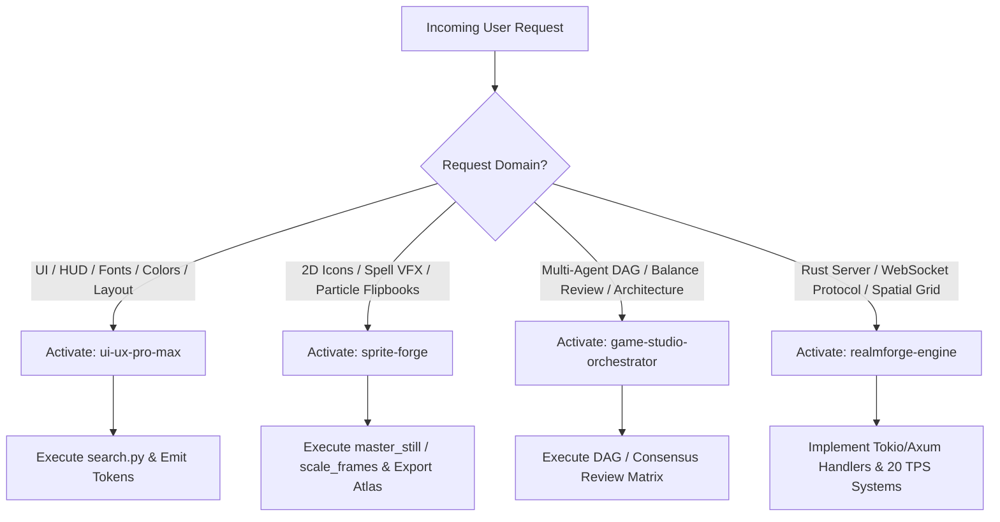

# Skill Activation Rules & Guardrails

This document defines the strict activation criteria, input preconditions, conflict resolution protocols, and prohibited operations for all integrated skills.

---

## 1. Activation Decision Matrix

---

## 2. Granular Skill Activation Rules

### 2.1. Skill 1: `ui-ux-pro-max`

#### Trigger Keywords
`HUD`, `UI`, `UX`, `design system`, `color palette`, `typography`, `inventory layout`, `health bar`, `skill bar`, `login screen`, `modal`, `admin dashboard`, `tailwind styles`.

#### Preconditions
- The target component is rendered in the DOM layer (React / Next.js / Tailwind CSS / HTML) overlaying the Three.js viewport.
- The request requires aesthetic, layout, contrast, or token decisions.

#### Prohibited Operations
- **DO NOT** use `ui-ux-pro-max` to write Three.js WebGL vertex/fragment shaders.
- **DO NOT** use `ui-ux-pro-max` to generate binary texture files.
- **DO NOT** execute unconstrained queries without specifying the `--stack` and `--domain` flags.

---

### 2.2. Skill 2: `sprite-forge`

#### Trigger Keywords
`2D sprite`, `skill icon`, `status effect icon`, `inventory item icon`, `spell decal`, `particle flipbook`, `transparent PNG`, `sprite sheet`, `billboard texture`.

#### Preconditions
- The asset being produced is 2D raster art (icons, decals, billboard particle textures).
- The asset requires clean transparency (alpha channel), precise pixel scaling, or cycle animation packaging.

#### Prohibited Operations & Guardrails
- **DO NOT USE FOR 3D PLAYER CHARACTERS OR MAJOR BOSSES:** Characters and monsters in this project are 3D GLB models rigged in Blender to support dynamic equipment swapping and 360-degree rotation.
- **DO NOT** run video-to-sprite actions without user approval on the Master Still.
- **DO NOT** commit raw generated image outputs directly into the game client without passing through `scale_frames.py` and alpha quality checks.

---

### 2.3. Skill 3: `game-studio-orchestrator`

#### Trigger Keywords
`agent team`, `studio hierarchy`, `DAG task`, `cross-model review`, `consensus audit`, `balance curve review`, `GDD validation`.

#### Preconditions
- A complex, multi-stage task requiring sequential verification or dual-agent consensus (e.g., Antigravity implementation + Codex review).
- Generating economic mathematical curves, drop rate tables, or architecture security audits.

#### Prohibited Operations
- **DO NOT** launch the full 50-agent roster for trivial bug fixes or single-file edits.
- **DO NOT** expose the FastAPI dashboard (`port 8000`) to external public networks; restrict to `127.0.0.1`.

---

### 2.4. Skill 4: `realmforge-engine`

#### Trigger Keywords
`server loop`, `Tokio task`, `Axum WebSocket`, `opcode`, `spatial hash grid`, `interest management`, `packet serialization`, `auto-attack tick`, `enemy aggro`, `movement validation`.

#### Preconditions
- The task involves Rust backend engineering, WebSocket protocol synchronization, or server-side spatial logic.

#### Prohibited Operations
- **DO NOT** import Phaser 2D canvas code into the Three.js client repository.
- **DO NOT** store critical persistent player state solely in volatile `DashMap`; all permanent state transitions must be mapped to PostgreSQL transactions.

---

## 3. Conflict Resolution & Pipeline Handoffs

When a task spans multiple domains (e.g., "Implement a fireball skill with an action bar icon, visual effect, and server combat calculation"):

1. **Step 1 (Server Math & Opcode):** Invoke `realmforge-engine` to register the skill opcode (`MSG_USE_SKILL`), define cooldown and damage formula in `balance.json`, and implement the Tokio combat handler in Rust.
2. **Step 2 (2D Icon & Visual Flipbook):** Invoke `sprite-forge` to generate a 64x64 transparent icon for the fireball and an 8-frame particle flipbook for the impact burst.
3. **Step 3 (HUD Integration):** Invoke `ui-ux-pro-max` to style the skill slot cooldown sweep, hotkey indicator, and active border glow in Tailwind CSS.
4. **Step 4 (Verification):** Invoke `game-studio-orchestrator` to audit client-server opcode synchronization and cooldown race conditions.
