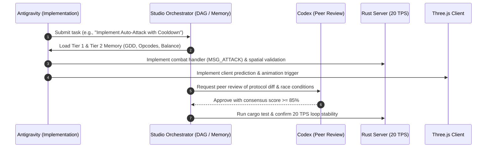

# Standard Operating Procedure: Game Development Workflow

This workflow guides the end-to-end development of gameplay systems, combining multi-agent orchestration (`agent-game-studio`), authoritative Rust networking (`realmforge`), and the Three.js client rendering engine.

---

## 1. Game Systems Engineering Architecture



---

## 2. Seven-Stage Feature Implementation Protocol

### Stage 1: Feature Specification & Balance Modeling
1. Load global balance curves from `shared/constants/balance.json`.
2. Define base damage equations, critical multipliers, range limits, and tick costs:
   $$\text{Damage} = \max\left(1, (\text{ATK} \times \text{SkillMultiplier}) - \text{DEF}_{\text{target}}\right) \times (\text{isCrit} ? 1.5 : 1.0)$$
3. Assign typed message opcode (e.g., `MSG_ATTACK = 4` or `MSG_USE_SKILL = 15`).

### Stage 2: Authoritative Rust Server Implementation
Implement game logic on the Rust backend (`server/src/combat.rs`):
- **Timestamp Validation:** Check that client monotonic timestamp satisfies:
  $$\Delta t \ge \text{attack\_cooldown\_ms} \times 0.95$$
- **Spatial Grid Check:** Query 16x16 spatial hash grid to ensure target entity is within weapon reach (e.g., 1.5 tiles for melee, 8.0 tiles for ranged).
- **Line-of-Sight & Collision:** Raycast against tile elevation masks.
- **State Mutation:** Deduct MP, apply damage to enemy HP in `AppState.enemies` (`DashMap` / PostgreSQL).
- **Localized Broadcast:** Distribute `MSG_DAMAGE_EVENT` packet exclusively to players in `nearby_cells`.

### Stage 3: Three.js Client Controller & Prediction
Implement corresponding client-side systems:
- **Orthographic Isometric Camera Setup:**
  ```typescript
  const aspect = window.innerWidth / window.innerHeight;
  const d = 20; // Orthographic view frustum size
  const camera = new THREE.OrthographicCamera(-d * aspect, d * aspect, d, -d, 1, 1000);
  camera.position.set(20, 20, 20); // 45-degree isometric angle
  camera.lookAt(0, 0, 0);
  ```
- **Local Prediction:** Immediately trigger character attack animation upon keypress; display local combat swing.
- **Server Reconciliation:** When `MSG_DAMAGE_EVENT` arrives from the WebSocket:
  - If target was hit: Spawn floating combat damage text and play target hit react animation.
  - If server rejected attack (out of range/cooldown): Cancel attack recovery and reset cooldown timer.

### Stage 4: Cross-Model Peer Review & Consensus Matrix
Before code is committed, invoke the multi-agent consensus arbiter (`agent-game-studio`):
1. **Antigravity (Gemini)** generates the Rust and TypeScript implementation.
2. **OpenAI Codex** executes a static security and concurrency audit:
   - Checks for thread deadlocks across `DashMap` or PostgreSQL connections.
   - Audits packet deserialization against buffer overflow or panic hazards.
   - Verifies that floating damage numbers cannot trigger client memory leaks.
3. If consensus score is $\ge 85\%$, the task advances to testing.

### Stage 5: Automated Testing
1. **Server Unit Tests:**
   ```bash
   cd server && cargo test combat_tests -- --nocapture
   ```
2. **Client Component Tests:**
   ```bash
   cd client && npm test
   ```
3. **Multi-Agent Orchestrator Verification:**
   ```bash
   python tools/agent-skills/game-studio/studio.py test
   ```

### Stage 6: Database Persistence Integration
For persistent player mutations (XP gain, loot drop acquisition, level-up):
- Enqueue transactional update to PostgreSQL via Tokio worker channel (`sqlx::query!`).
- Cache hot session stats (current HP, MP, coordinates) in Redis (`SETEX player:{uuid} 300 {json}`).

### Stage 7: Production Release & Rollback Checkpoint
- Tag repository commit.
- Run `make build` to verify end-to-end bundling.
- If packet desynchronization is observed in staging, revert to previous stable tag.
