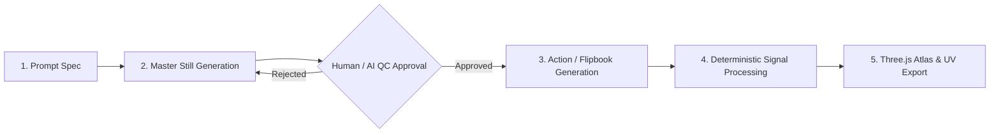

# Standard Operating Procedure: 2D Sprite & VFX Workflow

This workflow guides the generation, quality control, packaging, and Three.js integration of 2D assets using verified capabilities from `agent-sprite-forge`.

---

## 1. Hybrid 2D + 3D Asset Division Rules

Our Web MMORPG utilizes a **Hybrid 2D + 3D** architecture with an orthographic isometric camera:

| Asset Category | Asset Type | Representation | Source Pipeline | Rationale |
|---|---|---|---|---|
| **Player Characters** | All 4 Player Classes | **3D GLB Mesh** | Blender | Enables dynamic armor swapping, smooth skeletal animation, and 360° rotation. |
| **Major Bosses** | Raid & Dungeon Bosses | **3D GLB Mesh** | Blender | Complex attack hitboxes and multi-phase cinematic animations. |
| **Skill & Spell Icons** | 6-slot skills, spells, buffs | **2D Transparent PNG** | Agent Sprite Forge | 64x64 high-contrast UI icons for HUD action bars. |
| **Inventory Items** | Weapons, potions, armor | **2D Transparent PNG** | Agent Sprite Forge | 128x128 transparent icons for inventory grid tooltips. |
| **Particle Visual Effects** | Hit slashes, bursts, sparks | **2D Animated Flipbook** | Agent Sprite Forge | Lightweight 8-16 frame sprite sheets rendered on Three.js billboard quads. |
| **Ground Spell Decals** | AoE circles, elemental runes | **2D Texture Decal** | Agent Sprite Forge | Projected onto terrain geometry using Three.js decal shaders. |
| **Ambient Minions / Fauna** | Distant birds, critters, bugs | **2D Billboard Sprite** | Agent Sprite Forge | Massive rendering performance savings via `THREE.InstancedMesh`. |

---

## 2. Five-Stage Asset Creation Pipeline



### Stage 1: Asset Specification & Semantic Prompting
Define the visual target including perspective, lighting direction, and alpha background requirements:
```bash
python tools/agent-skills/sprite-forge/scripts/master_still.py prompt \
  --spec "Anime fantasy spell icon, blazing meteor strike, dark border, isometric lighting, clean background"
```

### Stage 2: Master Still Generation & Quality Approval
Generate candidate master takes and lock the approved frame:
```bash
# Generate 4 candidate takes via route_media.py (using Gemini Flash / OpenAI)
python tools/agent-skills/sprite-forge/scripts/master_still.py generate --takes 4

# Review takes and approve candidate 2
python tools/agent-skills/sprite-forge/scripts/master_still.py approve --take 2 --output assets/icons/spells/meteor_strike/
```
The approval script commits:
- `master.png` (Raw generation)
- `master_rgba.png` (Chroma-keyed transparent alpha)
- `master.json` (Bounding box coordinates and optical center)

### Stage 3: Multi-Frame Action / Flipbook Generation
For animated particle effects (such as a 12-frame slashing effect):
```bash
python tools/agent-skills/sprite-forge/scripts/sprite_set.py plan --master assets/vfx/slash/master.json --actions burst
python tools/agent-skills/sprite-forge/scripts/sprite_set.py run --actions burst
```

### Stage 4: Deterministic Signal Processing & Quality Control
Clean and normalize frames through Python signal processing:
1. **Background Spill QC:** Ensure zero halo or fringe artifacts remain:
   ```bash
   python tools/agent-skills/sprite-forge/scripts/sheet_qc.py spill --input assets/vfx/slash/raw_frames/
   ```
2. **Bounding Box Normalization & Scaling:** Scale all frames to a uniform 128x128 bounding box while preserving the ground anchor / visual pivot:
   ```bash
   python tools/agent-skills/sprite-forge/scripts/scale_frames.py --input assets/vfx/slash/raw_frames/ --size 128x128 --anchor center
   ```

### Stage 5: Three.js Atlas & UV Coordinate Packaging
Pack individual frames into a power-of-two texture atlas and emit UV metadata:
```bash
python tools/agent-skills/sprite-forge/scripts/export_threejs.py \
  --frames assets/vfx/slash/processed/ \
  --output client/public/assets/sprites/vfx_slash_atlas.png \
  --meta client/public/assets/sprites/vfx_slash_atlas.json
```

---

## 3. Three.js Client Integration Example

To render the animated 2D sprite flipbook in Three.js:

```typescript
import * as THREE from 'three';

export class AnimatedVFXSprite {
    private material: THREE.SpriteMaterial;
    private sprite: THREE.Sprite;
    private currentFrame: number = 0;
    private totalFrames: number = 12;
    private frameDuration: number = 0.05; // 50ms per frame
    private elapsed: number = 0;

    constructor(texture: THREE.Texture, cols: number, rows: number) {
        texture.wrapS = THREE.RepeatWrapping;
        texture.wrapT = THREE.RepeatWrapping;
        texture.repeat.set(1 / cols, 1 / rows);

        this.material = new THREE.SpriteMaterial({ 
            map: texture, 
            transparent: true,
            blending: THREE.AdditiveBlending // Glow effect for spell VFX
        });
        this.sprite = new THREE.Sprite(this.material);
    }

    public update(delta: number) {
        this.elapsed += delta;
        if (this.elapsed >= this.frameDuration) {
            this.elapsed = 0;
            this.currentFrame = (this.currentFrame + 1) % this.totalFrames;
            // Update texture UV offset
            const col = this.currentFrame % 4;
            const row = Math.floor(this.currentFrame / 4);
            this.material.map!.offset.x = col / 4;
            this.material.map!.offset.y = 1 - (row + 1) / 3;
        }
    }
}
```
