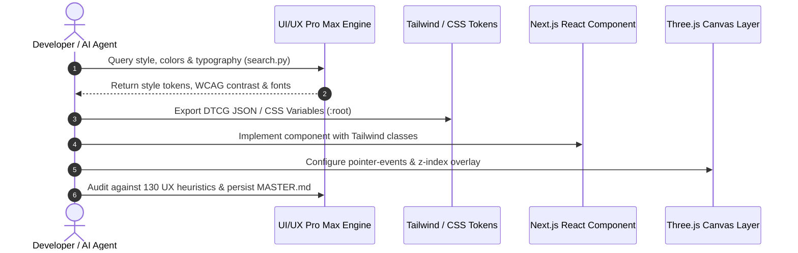

# Standard Operating Procedure: UI/UX Design Workflow

This workflow guides the design and implementation of Web MMORPG interfaces using verified capabilities from `ui-ux-pro-max-skill`.

---

## 1. Supported UI Components

This workflow applies to all DOM-rendered user interfaces overlaying the Three.js viewport:
- **Core In-Game HUD:** HP/MP/Stamina orbs and bars, Level indicator, Experience bar, Action & Skill bar (6-slot active skills + cooldown sweeps), Minimap frame, Status effect buff/debuff trays.
- **Gameplay Panels & Modals:** Inventory & Bag grid (rarity borders), Equipment paperdoll window, Character Attribute allocation panel, Quest journal & dialogue tree box, Multi-channel chat window (Local, Party, Guild, World), Party & Raid frames.
- **Game Progression & Meta Menus:** Guild management dashboard, Player-to-player trade window, Auction house & merchant shop, Talent & skill tree browser.
- **Out-of-Game Portals:** Landing & Registration page, Server/Realm selection list, 3D Character Creation suite (with Three.js model preview), Settings modal (Graphics, Audio, Keybindings), Game Master / Admin dashboard.

---

## 2. Six-Step UI Engineering Workflow



### Step 1: Component Requirements & Density Definition
Determine the target interface density and motion dial:
- **In-Game Combat HUD:** Requires high data density (`--density 8`), high contrast for fast readability during action battles, and minimal visual obstruction.
- **Out-of-Game Character Creation:** Requires spacious layout (`--density 4`), high visual flair (`--variance 7`), and cinematic typography.

### Step 2: Intelligence Querying via `search.py`
Query the local BM25 design engine:
```bash
# Query anime dark-fantasy style rules
python tools/agent-skills/ui-ux-pro-max/scripts/search.py "anime dark fantasy mmorpg" --domain style --stack threejs

# Query health/mana bar color palettes with contrast verification
python tools/agent-skills/ui-ux-pro-max/scripts/search.py "health mana energy gradient" --domain color

# Query fantasy RPG font pairings
python tools/agent-skills/ui-ux-pro-max/scripts/search.py "fantasy rpg clean" --domain typography
```

### Step 3: Design Token Generation & Persistence
Export tokens directly to CSS custom properties or Tailwind configuration:
```bash
python tools/agent-skills/ui-ux-pro-max/scripts/search.py "anime-rpg-hud" --tokens css --persist --page hud
```
This generates:
- `client/src/styles/tokens.css` (defining `--color-hp-fill`, `--color-mp-fill`, `--border-rarity-mythic`)
- `design-system/hud/MASTER.md` (recording all design decisions)

### Step 4: Component Implementation (Next.js + Tailwind CSS)
Build the component ensuring standard accessibility and state reactivity:
- **Action Bar Example (`SkillBar.tsx`):**
  - Uses CSS grid (`grid-cols-6 gap-2`).
  - Active cooldown sweep using SVG circular stroke-dashoffset or semi-transparent mask.
  - Hotkey indicators styled with high-contrast badge styling.
  - Active buff aura styled with subtle CSS keyframe glow.

### Step 5: Three.js Overlay Integration & Event Bubbling
To prevent UI mouse clicks from triggering unintended character movements in the Three.js 3D world:
1. Ensure the UI container uses `pointer-events-none`.
2. Interactive buttons, slots, and input fields explicitly enable `pointer-events-auto`.
3. Stop event propagation on drag-and-drop inventory actions:
   ```typescript
   const handlePointerDown = (e: React.PointerEvent) => {
       e.stopPropagation();
   };
   ```

### Step 6: UX Anti-Pattern & Accessibility Audit
Audit the component against `src/ui-ux-pro-max/data/ux-guidelines.csv`:
- Check minimum clickable touch targets (minimum 44x44px for mobile/tablet, 36x36px for desktop).
- Verify contrast ratio (minimum 4.5:1 for standard text, 3:1 for large headers).
- Verify tooltip positioning avoids viewport edge clipping.
