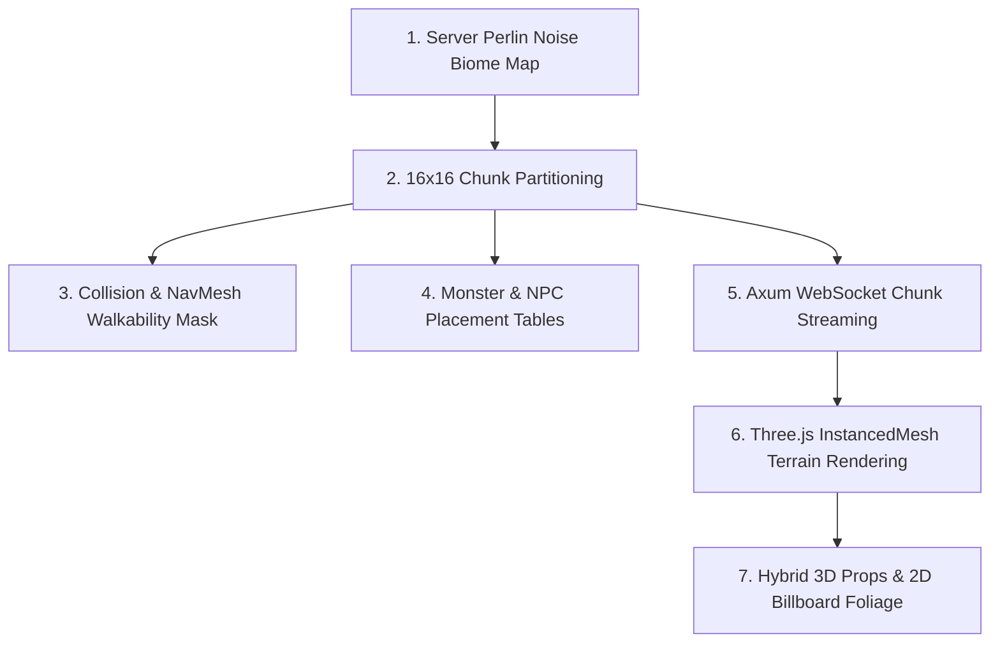

# Standard Operating Procedure: World Building & Zone Workflow

This workflow guides the procedural generation, zone layout, NPC/monster placement, and Three.js scene streaming using verified patterns from `realmforge` and `agent-sprite-forge`.

---

## 1. World Architecture & Coordinate Systems

```
Server World Space (Discrete 2D Grid)
        (x, y) coordinates
             │
             ▼
Spatial Hash Grid: 16x16 tile chunks
             │
             ▼
Client Three.js Viewport (Continuous 3D Space)
        X = (x - y) * (sqrt(3)/2) * TileWidth
        Z = (x + y) * 0.5 * TileHeight
        Y = elevation * StepHeight
```

- **Tile Unit:** 1 discrete game tile = 1.0 meter in Three.js continuous space.
- **Chunk Size:** 16x16 tiles (256 tiles per chunk).
- **Coordinate Partitioning:** Spatial key $K = (x \gg 4, y \gg 4)$.
- **Network Streaming:** Chunks are requested on-demand via `MSG_REQUEST_CHUNK = 12`.

---

## 2. World Building Pipeline



---

## 3. Step-by-Step Zone Implementation

### Step 1: Biome Noise Parameter Tuning
In `server/src/world.rs`, configure multi-octave Perlin noise generators for elevation and moisture:
```rust
let elevation = perlin.get([x as f64 * 0.02, y as f64 * 0.02]);
let moisture = perlin.get([x as f64 * 0.015 + 100.0, y as f64 * 0.015 + 100.0]);
```
- **8 Biomes:**
  1. `Town / Sanctuary`: Static pre-built safe zone (PvP disabled, merchants, bank).
  2. `Plains / Grassland`: Low elevation, medium moisture (Starter zone, passive monsters).
  3. `Deep Forest`: Medium elevation, high moisture (Aggressive wildlife, wood gathering).
  4. `Arid Desert`: High elevation, low moisture (High movement penalty, rare ores).
  5. `Rocky Mountains`: High elevation, low moisture (Impassable terrain walls, elite caves).
  6. `Misty Swamps`: Low elevation, very high moisture (Poison debuffs, fishing nodes).
  7. `Frozen Tundra`: High elevation, high moisture (Ice friction, high-level elementals).
  8. `Volcanic Rift`: Very high elevation (Endgame raid zone, dynamic lava hazards).

### Step 2: Walkability & Collision Bitmask Generation
Each 16x16 chunk generates a 256-bit collision bitmask:
- Bit `0`: Walkable (Flat terrain, paved paths).
- Bit `1`: Impassable (Water, deep lava, cliff faces, solid walls).
- Bit `2`: Dynamic Obstacle (Destructible rocks, closed gates).
The server uses this bitmask for authoritative A* pathfinding and validation of `MSG_MOVE` packets.

### Step 3: Monster Pack Placement & Spawning Rules
Define spawn zones in `server/src/enemy.rs` with pack behavior:
```rust
pub struct SpawnRule {
    pub enemy_id: u32,
    pub tier: EnemyTier, // Normal, Champion, Elite, WorldBoss
    pub biome: BiomeType,
    pub pack_size: Range<u8>, // e.g. 2..5
    pub respawn_interval_seconds: u32, // e.g. 45s
    pub leash_radius_tiles: f32, // e.g. 12.0 tiles
}
```
- **Pack Aggro Mechanic:** When an enemy enters combat, it alerts all allies within a 6-tile radius.
- **Leash Mechanic:** If a player lures an enemy beyond its `leash_radius`, the enemy disengages, becomes invulnerable, and walks back to its spawn anchor.

### Step 4: NPC Placement & Dialogue Trees
Place quest givers and merchants in sanctuary zones:
- Assign UUID and static coordinate anchor `(x, y, elevation)`.
- Associate dialogue node graph (compatible with `MSG_NPC_INTERACT = 23`).
- Bind merchant inventory tables (consumables, weapons, gathering tools).

### Step 5: Three.js Client Terrain & Prop Rendering
To achieve 60+ FPS on web browsers:
1. **Terrain Instancing:** Render ground tiles using `THREE.InstancedMesh` with a single draw call per chunk.
2. **Frustum & Occlusion Culling:** Three.js automatically hides chunks outside the orthographic camera frustum.
3. **Environment Props (Hybrid 3D + 2D):**
   - **3D Hero Props:** Buildings, bridges, statues, and gates are loaded as optimized GLB meshes.
   - **2D Billboard Foliage:** Distant trees, grass tufts, and bushes are rendered using `THREE.InstancedMesh` with 2D billboard textures generated via `agent-sprite-forge`.
4. **Day/Night Cycle & Isometric Lighting:**
   - Directional light positioned at $(50, 80, 50)$ casting sharp orthographic shadows.
   - Ambient light color smoothly interpolates between day (warm golden `#FFF4E0`) and night (cool deep blue `#1A2238`).
